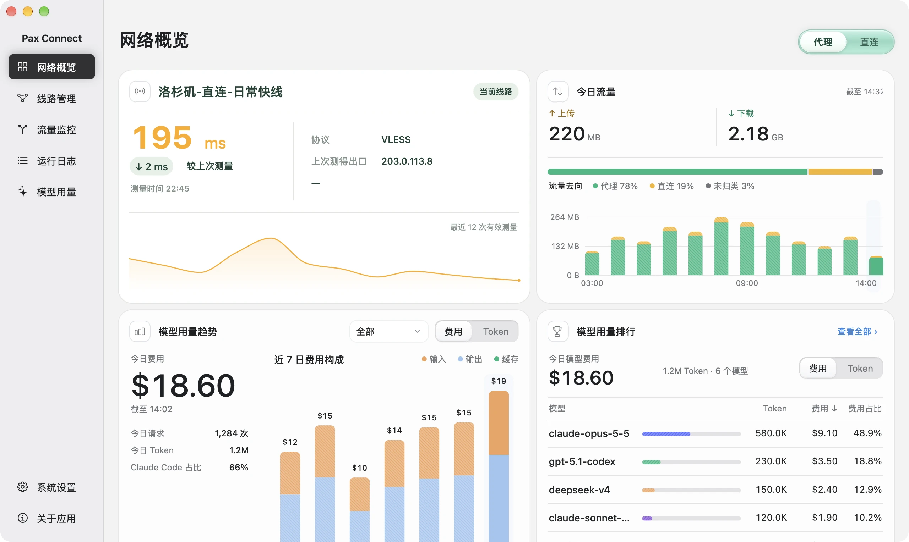
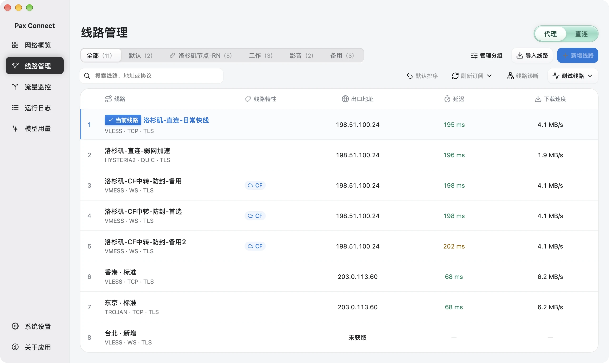
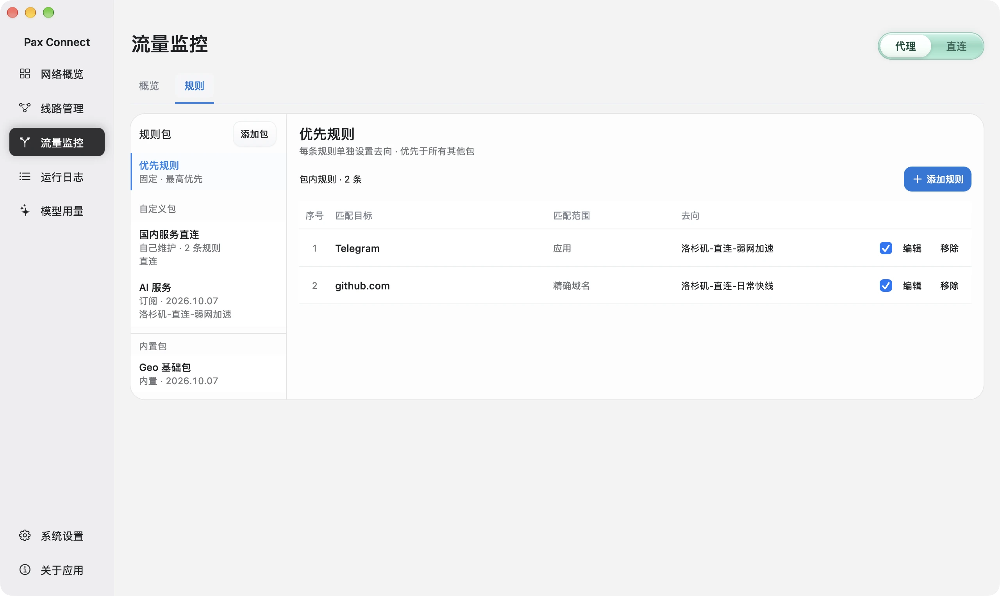
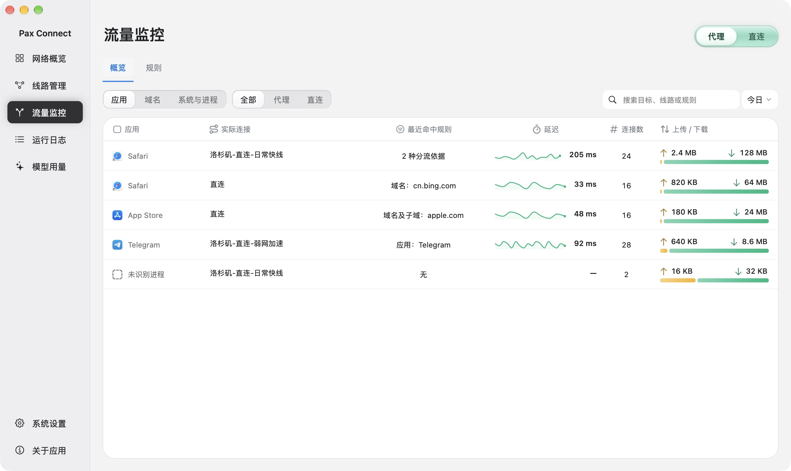
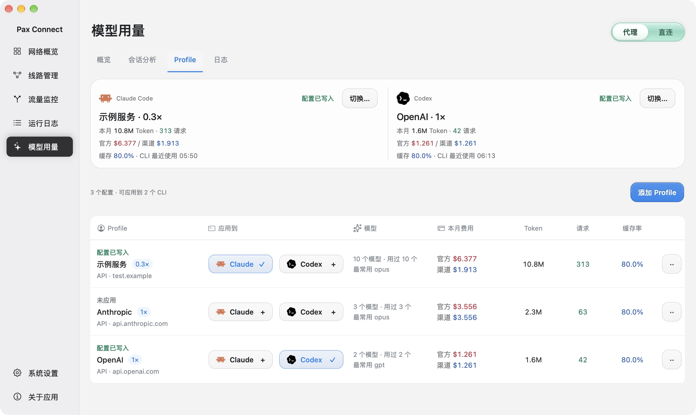
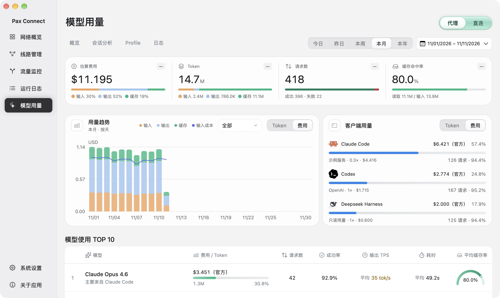
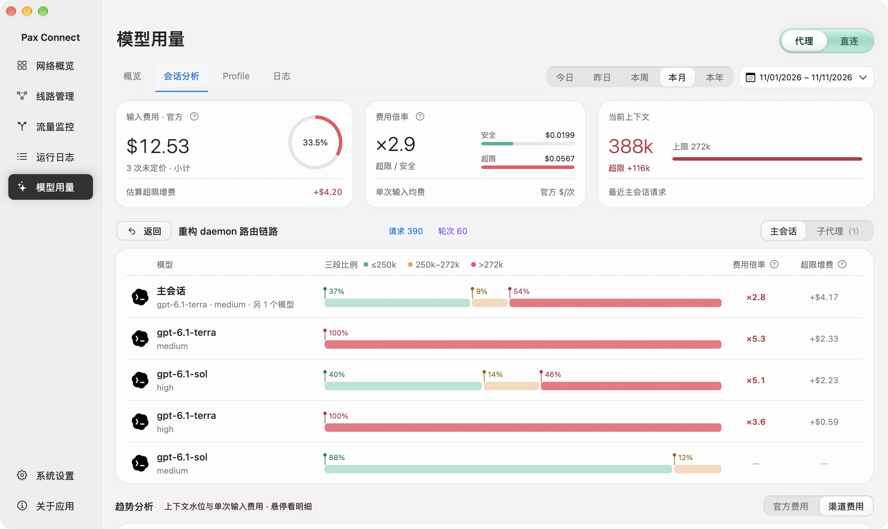
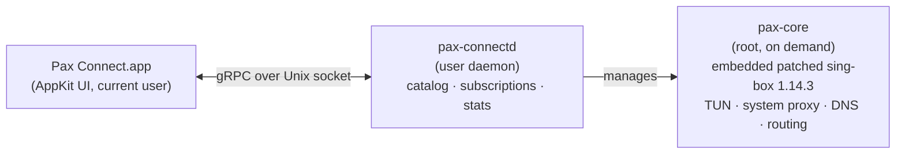

<div align="center">


# Pax Connect

**The Mac proxy client for Claude Code and Codex.**
Route traffic, switch API profiles, and see token usage and cost, all in one native app.

[](LICENSE)

[](https://github.com/Moore-developers/pax-connect-app/releases/latest)
[](https://github.com/SagerNet/sing-box)

[Download](https://github.com/Moore-developers/pax-connect-app/releases/latest) ·
[Website](https://paxconnect.top) ·
[Build from source](#build-from-source) ·
[中文](README.zh-CN.md)

<br>



<sub>Demo mode with simulated data. The app interface is currently Chinese only.</sub>

</div>

## What it does

Pax Connect is a [sing-box](https://github.com/SagerNet/sing-box) based proxy client for macOS, designed for developers who code with Claude Code and Codex every day. It brings three jobs into one app:

- **Route through a proxy.** Take over system traffic with TUN (or the system proxy), so terminal tools such as `claude` and `codex` need no `HTTPS_PROXY` setup. Rules match by `.app` application, domain, or IP and send traffic to a route, direct, or block.
- **Manage API profiles.** Save several API service addresses and apply one to Claude Code (`settings.json`) and Codex (`config.toml`). Saving and applying are separate steps.
- **Track usage and cost.** Read local Claude Code, Codex and DeepSeek Harness logs and total tokens, cache and estimated cost by date, model and session. Cost is an API-equivalent estimate, not a bill.

Pax Connect is an independent client, not an official sing-box product. It ships **no proxy servers or routes**: you bring your own (node links or subscriptions) and your own API service.

## Screenshots

<table>
  <tr>
    <td width="50%"><br><b>Connections</b><br><sub>Import node links or subscriptions, pick the current route, test latency and speed.</sub></td>
    <td width="50%"><br><b>Routing rules</b><br><sub>Rule packages; priority rules by application, domain or IP; destination proxy, direct or block.</sub></td>
  </tr>
  <tr>
    <td width="50%"><br><b>Traffic monitoring</b><br><sub>Per-application actual route, matched rule, connections and transfer.</sub></td>
    <td width="50%"><br><b>API profiles</b><br><sub>Claude Code and Codex cards show which profile is written to each client.</sub></td>
  </tr>
  <tr>
    <td width="50%"><br><b>AI usage</b><br><sub>Estimated cost, tokens, requests, cache and client distribution.</sub></td>
    <td width="50%"><br><b>Session analysis</b><br><sub>Parent session and subagents shown separately, with a per-request trend.</sub></td>
  </tr>
</table>

## Features

**Network**

- TUN takeover or system proxy; switch routes without dropping TUN.
- Rules by `.app` application, domain, or IP, with destination proxy, direct, or block. Built-in packages for private networks, Google, and China domains and IPs.
- An optional ad-blocking rule package (domain based, **off by default**).
- Traffic and connection logs: actual route and matched rule per application.
- If another VPN/TUN tool holds the network, Pax detects it and asks you to turn it off. It never stops other tools for you.

**Routes**

Importing supports share links and Base64 subscriptions for these protocols (see [`daemon/internal/importers`](daemon/internal/importers)):

`VLESS` (incl. Reality, Vision flow, ws, httpupgrade) · `VMess` · `Trojan` · `Hysteria2` (salamander obfuscation) · `AnyTLS` · `Shadowsocks`

Not importable: Clash YAML, sing-box JSON, VLESS over XHTTP. Unsupported options in a link are rejected rather than silently dropped.

**AI tools**

- Local usage for Claude Code, Codex and DeepSeek Harness, read from their local logs (`~/.claude`, `~/.codex`, `~/.dsh`).
- Session analysis with parent and subagent breakdown.
- Profiles applied to Claude Code `settings.json` and Codex `config.toml`.

## Install

> **Requirements:** a Mac with **Apple Silicon**, running **macOS 26 or later**. Intel Macs are not supported.

1. Download the DMG from the [latest release](https://github.com/Moore-developers/pax-connect-app/releases/latest).
2. Open it and drag `PaxConnect.app` to **Applications**. Eject the DMG and open Pax Connect from Applications.
3. This beta is **not notarized** (no Apple Developer ID). macOS may block the first launch. Open **System Settings → Privacy & Security**, find the notice for Pax Connect, click **Open Anyway**, and confirm. Do not disable Gatekeeper.
4. Import your own routes, then turn the proxy on.

Things worth knowing:

- **The first time you turn the proxy on, Pax asks for your administrator password once.** It is entered in a secure input box inside Pax and used to start the network core (`pax-core`) as root. Pax does not change `sudoers` and does not cache the password. Cancelling leaves the proxy off. This is separate from the Gatekeeper prompt above.
- **Turn off other VPN / TUN apps** before enabling Pax's TUN mode.
- **Closing the window does not quit the app.** Press **⌘Q** to quit Pax and its background processes; turning the proxy off releases the network Pax took over.
- **The interface is Chinese only for now.**
- **Your data** (routes, subscriptions, API profiles, local records) lives in `~/Library/Application Support/Pax Connect/`. It can contain credentials; do not share it. Error logs are in `~/Library/Logs/Pax Connect/`. Updating or deleting the app does not remove this folder; downgrading is not supported.

## Privacy

- **No telemetry or analytics in the app.**
- AI usage is **read locally from CLI logs**. It does not pass through any Pax gateway. Your AI requests go from your tools to your provider as before.
- The app only uses the network for: subscription refreshes, rule updates and website icons you trigger; route tests and diagnostics (test destinations, IP info, DNS, STUN); and the model catalog from the API address you saved.
- Credentials are stored in private local files (mode 0600). That is file permission, not an encrypted vault.

More detail: [paxconnect.top/privacy](https://paxconnect.top/privacy/).

## How it works



- The app launches `pax-connectd` as a child process under your user account. It handles the route catalog, subscriptions, speed tests, config generation and statistics.
- `pax-core` runs as root only when the proxy is first turned on. It embeds a patched [sing-box](https://github.com/SagerNet/sing-box) 1.14.3 and owns TUN, the system proxy, DNS and routing. It exits with the app.
- The app never talks to sing-box directly; the only app IPC is the gRPC API in [`api/`](api).

Details: [`docs/architecture/runtime.md`](docs/architecture/runtime.md), [`docs/architecture/singbox.md`](docs/architecture/singbox.md).

## Build from source

**Prerequisites**

- Apple Silicon Mac, macOS 26
- Xcode 26+ (Swift 6 toolchain)
- Go 1.26.x (see [`daemon/go.mod`](daemon/go.mod))
- Python 3 and `patch` (used by the build to prepare sing-box)
- `protoc` and its plugins, **only** if you regenerate protobuf code: see [`scripts/gen-proto.sh`](scripts/gen-proto.sh). Generated Go code is checked in.

**Build**

```sh
make daemon                        # pax-connectd + pax-core (arm64) -> build/
make app                           # builds the daemon, then the AppKit app
scripts/package-release.sh 0.1.0   # Release app + DMG -> build/releases/
```

- `make app` output: `build/DerivedData/Build/Products/Debug/PaxConnect.app`.
- `scripts/package-release.sh <version>` signs ad hoc (no Developer ID, no notarization) and writes to `build/releases/PaxConnect-<version>-<build>-arm64/`. Creating the DMG needs a graphical login session and Finder automation permission.
- Go builds go through `scripts/go.sh`. It downloads the pinned sing-box and sing-tun sources and applies the patches in [`patches/`](patches) (checksum-verified) into the git-ignored `.tools/` directory.
- `GOPROXY` defaults to `https://goproxy.cn,direct`; override it if you prefer: `GOPROXY=https://proxy.golang.org,direct make daemon`.

## Repository layout

| Path | Contents |
|---|---|
| `api/` | Protobuf definitions for app ⇄ daemon and daemon ⇄ core |
| `daemon/` | Go: `pax-connectd` and `pax-core` |
| `macos/` | AppKit app, Xcode project, Swift packages (UI, features, gRPC client) |
| `patches/` | Patches and guards applied to sing-box and sing-tun |
| `rulesets/` | Bundled rule sets (`.srs`) and their manifest |
| `scripts/` | Build, packaging and code generation scripts |
| `third_party/` | Third-party license texts |
| `docs/` | Architecture notes and images |

## License

Pax Connect is licensed under the **GNU General Public License v3.0** ([LICENSE](LICENSE)). It links [sing-box](https://github.com/SagerNet/sing-box), which is GPL-3.0-or-later. The patched sing-box and sing-tun changes are in [`patches/`](patches). Other components keep their own licenses: see [THIRD_PARTY_NOTICES.md](THIRD_PARTY_NOTICES.md).

**Trademarks.** Pax Connect is not affiliated with or endorsed by Anthropic, OpenAI or DeepSeek. Claude, Claude Code, Codex, OpenAI, DeepSeek and other names and icons belong to their respective owners and are used only to identify the tools Pax works with.

**Credits.** [sing-box](https://github.com/SagerNet/sing-box) and the SagerNet projects, the [gRPC Swift](https://github.com/grpc/grpc-swift-2) and [SwiftNIO](https://github.com/apple/swift-nio) teams, [v2fly domain-list-community](https://github.com/v2fly/domain-list-community), [MaxMind GeoLite2](https://www.maxmind.com/), [217heidai/adblockfilters](https://github.com/217heidai/adblockfilters), [Simple Icons](https://simpleicons.org/), [Lobe Icons](https://github.com/lobehub/lobe-icons) and [Lucide](https://lucide.dev/).

Copyright (C) Pax Connect contributors.
