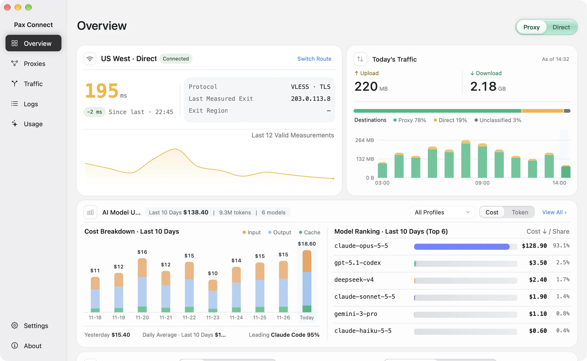
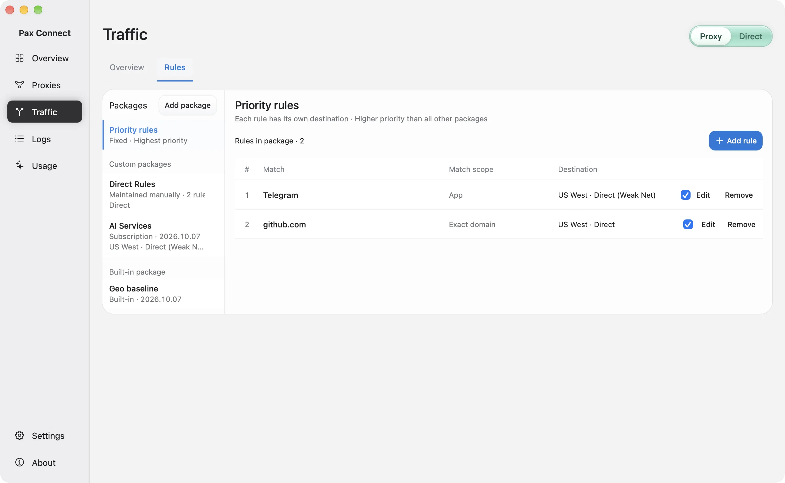
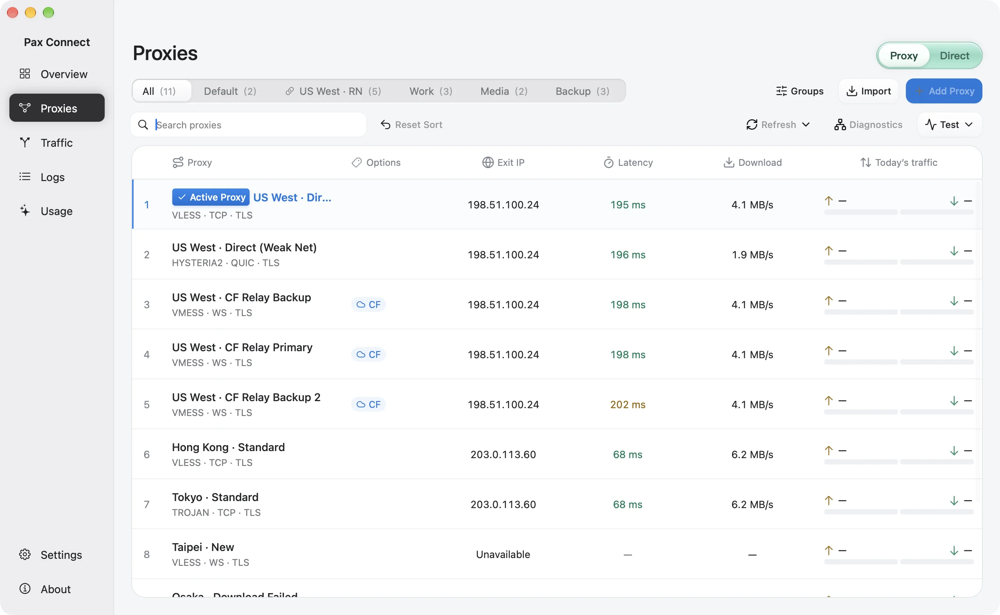
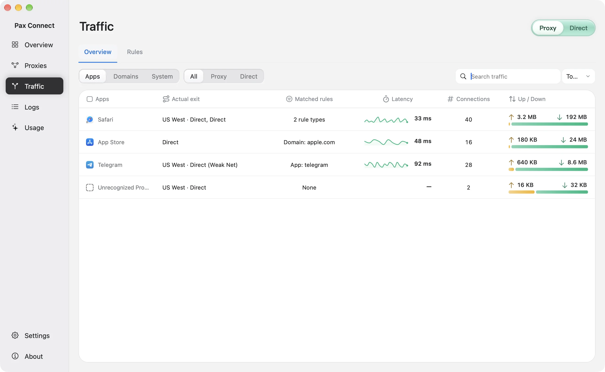
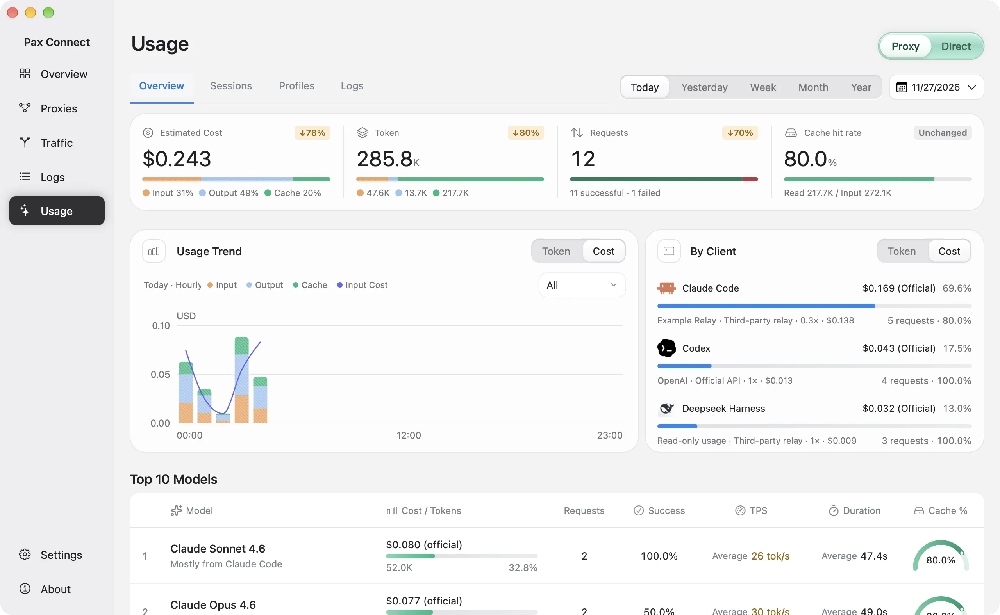
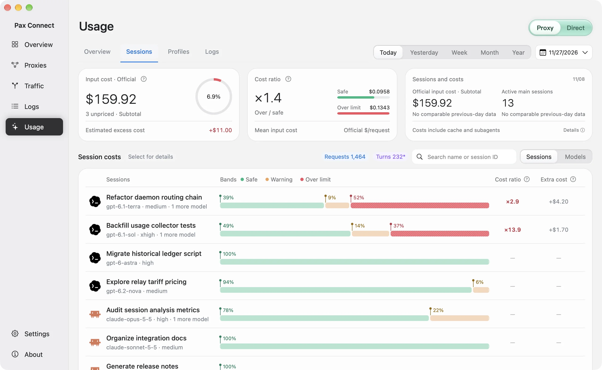
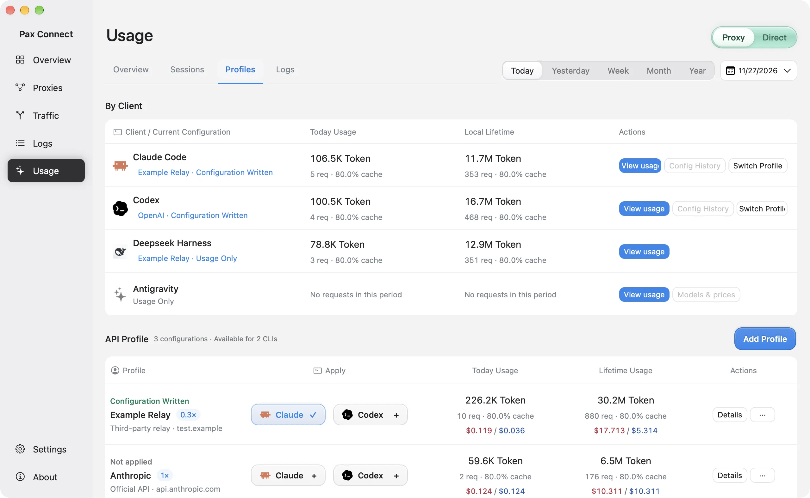
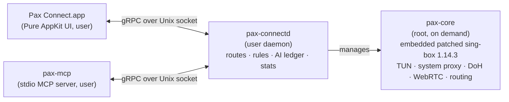

<div align="center">


# Pax Connect

**A Liquid Glass native Mac proxy for developers — effortless setup, leak-safe by default.**

Pure AppKit, no Electron, no YAML. Default split routing and DNS/WebRTC protection, fail-closed pinned routes, plus 1-click Claude/browser checks and local token cost tracking.

[](#install)

[](https://github.com/SagerNet/sing-box)
[](https://github.com/Moore-developers/pax-connect-app/releases/latest)
[](LICENSE)

[Download](https://github.com/Moore-developers/pax-connect-app/releases/latest) ·
[Website](https://paxconnect.top) ·
[Compare](#built-for-mac-developers-how-pax-compares) ·
[Install](#install) ·
[中文](README.zh-CN.md)

<br>



<sub>Demo mode with simulated data. Pax Connect ships no servers or nodes — bring your own routes and APIs.</sub>

</div>

---

## Built for Mac developers: how Pax compares

General-purpose proxies handle basic tunneling well, but leave terminal routing, leak verification, and AI cost tracking to external tools. Pax unifies the workflow in one native Mac interface:

- **Zero-YAML onboarding:** Import subscriptions, share links, Clash YAML, or sing-box JSON and connect — no rule files or `HTTPS_PROXY` env vars required.
- **Pure AppKit craft:** Crafted in Swift 6 and AppKit for macOS 26 Liquid Glass, controllable from the main window or menu bar with zero Electron overhead.
- **AI safety & cost built in:** Leak-safe split routing by default, fail-closed pinned routes, 1-click browser/Claude diagnostics, and local 4-tool token accounting.

| | **Pax Connect** | **Clash Verge Rev / Clash** | **v2rayN** | **Surge** |
|---|---|---|---|---|
| **Interface** | Pure AppKit · Liquid Glass | Cross-platform WebView (Tauri) | Cross-platform desktop (Avalonia) | Native macOS / iOS |
| **Defaults** | Built-in CN/overseas split + DoH/WebRTC protection | Rule templates & manual YAML | Manual routing & core settings | Power-user profiles & scripts |
| **Terminal (`claude`, `codex`)** | TUN takeover + point-and-click `.app` / CLI binary rules | TUN or custom rules | TUN / system proxy | Enhanced Mode |
| **Pinned-route cutoff** | Built-in: blocks new traffic & drops old sockets if dead | Custom fallback configuration | Not built-in | Policy / scripting |
| **Browser & Claude check** | 1-click Mac vs. browser IP, 6 Claude checks, DNS/WebRTC/IP | Not built-in | Not built-in | Not built-in |
| **AI usage & API profiles** | Local logs for 4 AI tools + Claude/Codex config switching | Not built-in | Not built-in | Not built-in |
| **Import formats** | Links, Base64, Clash YAML, sing-box JSON, SOCKS5/HTTP/HTTPS | Subscriptions, Clash YAML | Links, subscriptions, JSON | Surge profiles |
| **Platform & price** | macOS 26+ (Apple Silicon) · Free (Beta) | Win / Mac / Linux · Free (GPL-3.0) | Win / Mac / Linux · Free (GPL-3.0) | Mac / iOS · Paid (\$49.99+ Mac) |

> **Choosing the right fit:** Need Windows or Linux? Use **Clash Verge Rev** or **v2rayN**. Need iOS sync and HTTPS MITM debugging? Use **Surge**. On Apple Silicon Mac and want a refined, zero-YAML client tuned for AI coding? Try **Pax Connect**.

---

## 1. Leak-safe split routing, active from minute one



- **Default China/overseas split routing:** Bundled offline Geo rules route **LAN → Direct**, **Google → Proxy** (ahead of CN), **CN domains/IPs → Direct**, and **everything else → Proxy**. Optional ad-block package included (off by default).
- **DNS & WebRTC protection on by default:** TUN routes overseas DNS via proxy DoH (`1.1.1.1`/`8.8.8.8`) and direct/CN DNS via domestic DoH (`223.5.5.5`/`119.29.29.29`) with no plaintext fallback (or toggle **Strict DNS Privacy**). Public WebRTC STUN is forced through the proxy on new installs.
- **Point-and-click app & CLI rules:** Select `.app` bundles or executables (such as `claude`) sorted by recent traffic, and route them to the active node, a **pinned route**, direct, or block.
- **Three safeguards for sensitive accounts:** Enable the built-in **Claude package** (core + Google login/Stripe/Persona); **pinned routes refuse new connections/DNS and close stale sockets** if unloaded or unhealthy while TUN is active; and **2-hop chains** pair any relay with a clean static or residential exit (`SOCKS5`/`HTTP`/`HTTPS` included).

---

## 2. Verify real egress and Claude setup in one click

Runs strictly on demand when clicked — zero background probing:

- **Mac vs. real browser egress:** Launches a silent local loopback check in your default browser to expose daemon-vs-browser IP mismatches.
- **Claude 6-point + Keychain check:** Verifies Claude web & API egress, official component status, Cloudflare edge colo, HTTP/TLS protocol version, and local `Claude Code-doctor-probe` Keychain entries.
- **Leak & multi-source IP audit:** Surfaces real DNS resolver paths (via bash.ws), WebRTC STUN, IPv6, macOS Location Services, language/timezone, alongside direct queries from IPQuery, ipwho.is, ip.sb, GeoJS, InternetDB, and Cloudflare/IPinfo/IPIP — flagging any provider disagreements upfront.

---

## 3. Routes, Cloudflare optimizer, and live traffic

<table>
  <tr>
    <td width="50%"><br><b>Routes, 2-hop chains &amp; daily traffic</b><br><sub>Independent latency, speed, and exit tests. Hover daily upload/download for 5m / 1h(2h) / 24h thresholds and Top 3 targets.</sub></td>
    <td width="50%"><br><b>Full per-app traffic visibility</b><br><sub>Live exit route, matched rule, connections, and blocks per app, process, or domain — add rules in one click or inspect 6-column SQLite logs.</sub></td>
  </tr>
</table>

- **Built-in Cloudflare IP optimizer:** Scan CF edge IPs directly, benchmark latency/region/download speed, and validate candidates against your route draft before saving.
- **Proactive alerts & menu bar control:** Receive macOS notifications for cross-route per-app traffic spikes. Toggle the proxy and switch routes cleanly from the menu bar (old node connections close automatically; conflicting VPNs trigger a prompt).

---

## 4. Spot context bloat and AI token costs early

<table>
  <tr>
    <td width="50%"><br><b>4 coding tools, one local ledger</b><br><sub>Reads Claude Code, Codex, DeepSeek Harness, and Antigravity locally — estimated API-equivalent cost, tokens, cache rate, latency, and TPS.</sub></td>
    <td width="50%"><br><b>Know when to start a new session</b><br><sub>Splits parent sessions from subagents, shows Safe/Warning/Over-Limit spend bands, and flags when long context starts multiplying your cost.</sub></td>
  </tr>
</table>

- **Zero gateway, 100% local read-only:** Parses local logs and SQLite on disk — prompts and API keys never pass through Pax.
- **Catch context bloat before burning quota:** Buckets every turn against per-model cost thresholds (**Safe / Warning / Over-Limit**), showing cost multipliers, estimated excess spend, and parent vs. subagent breakdown.

---

## Built-in extensions: API profiles & local MCP

<table>
  <tr>
    <td width="50%"><br><b>API profiles (Claude Code &amp; Codex)</b><br><sub>Distinguishes official logins, official APIs, and relays automatically. Save multiple endpoints, preview diffs, and apply cleanly to <code>settings.json</code> or <code>config.toml</code>.</sub></td>
    <td width="50%"><b>Local MCP server (59 tools · 8 domains)</b><br><br>Connect Claude Code, Codex, or DeepSeek Harness in <b>Settings → MCP</b>. Defaults to <b>read-only</b>; management, diagnostics, profiles, and CF scan permissions are opt-in.<br><br><sub>Ask your agent directly:</sub><br><sub>• <i>"Check Pax logs for why Anthropic API timed out and run a route diagnostic."</i></sub><br><sub>• <i>"Which session had the highest over-limit context cost this week?"</i></sub></td>
  </tr>
</table>

---

## Install

> **Requirements:** **Apple Silicon** Mac running **macOS 26 or later**. Intel Macs are not supported.

1. Download the DMG from the [latest release](https://github.com/Moore-developers/pax-connect-app/releases/latest).
2. Drag `PaxConnect.app` into **Applications**, eject the DMG, and launch it.
3. **First launch (unnotarized beta):** Open **System Settings → Privacy & Security**, click **Open Anyway** next to Pax Connect, and confirm. *(Do not disable Gatekeeper.)*
4. Import your routes (or add a manual proxy) and toggle the proxy on.

<details>
<summary><b>First-run notes &amp; local data</b></summary>

- **Admin password once per proxy start:** Entered inside Pax to start `pax-core` as root. Never modifies `sudoers` or caches your password.
- **Disable other VPN / TUN apps** before enabling Pax TUN mode.
- **Closing the window keeps Pax running** in the menu bar. Press **⌘Q** to quit completely; turning the proxy off restores your system network.
- **Language & data:** Switch EN / 简体中文 live in Settings. Local data resides in `~/Library/Application Support/Pax Connect/` (`0600` private files — do not share); logs reside in `~/Library/Logs/Pax Connect/`.

</details>

---

## Privacy & boundaries

- **Zero telemetry, bring your own routes.** Independent client (not an official sing-box app); provides no proxy servers or API credits.
- **Security boundaries:** Pinned-route blocking operates while Pax and TUN are active (no OS crash firewall if Pax crashes or TUN exits); app-internal DoH and non-TUN traffic bypass TUN DNS.
- **Cost & storage:** AI costs are local API-equivalent estimates, not provider bills. Credentials use `0600` file permissions, not an encrypted keychain vault.
- **MCP:** Requires Pax to be running; tool results (logs, domains, sessions) may be sent to your AI client's provider. Details: [paxconnect.top/privacy](https://paxconnect.top/privacy/).

---

## Technical details

<details>
<summary><b>Supported protocols &amp; import formats</b></summary>

Share links, Base64 subscriptions, Clash/Mihomo YAML, sing-box JSON, or manual entry (see [`daemon/internal/importers`](daemon/internal/importers)):

- **Tunnel protocols:** `VLESS` (REALITY, Vision, WebSocket, HTTPUpgrade, single-service gRPC with TLS/REALITY) · `VMess` · `Trojan` · `Hysteria2` (salamander) · `AnyTLS` · `Shadowsocks`
- **Manual proxies:** `SOCKS5` · `HTTP` · `HTTPS` (optional auth and SNI)
- Unsupported transports (e.g., VLESS XHTTP, multi-mode gRPC) return explicit import errors.

</details>

<details>
<summary><b>Architecture (strict privilege separation)</b></summary>



- `Pax Connect.app` runs as your user and spawns `pax-connectd`; `pax-core` runs as root only while proxy is on, embedding checksum-verified patched [sing-box](https://github.com/SagerNet/sing-box) 1.14.3.
- UI and `pax-mcp` communicate solely via typed gRPC in [`api/`](api). Details: [`docs/architecture/runtime.md`](docs/architecture/runtime.md), [`docs/architecture/singbox.md`](docs/architecture/singbox.md).

</details>

<details>
<summary><b>Build from source &amp; repository layout</b></summary>

**Prerequisites:** Apple Silicon Mac (macOS 26), Xcode 26+ (Swift 6), Go 1.26.x ([`daemon/go.mod`](daemon/go.mod)), Python 3, `patch`.

```sh
make daemon                        # pax-connectd + pax-core (arm64) -> build/
make app                           # builds daemon + AppKit app -> build/DerivedData/...
scripts/package-release.sh 0.1.9   # ad-hoc signed Release app + DMG -> build/releases/
```

Go builds run via `scripts/go.sh` (fetches pinned sing-box/sing-tun and applies checksum-verified [`patches/`](patches)). Override `GOPROXY` if needed: `GOPROXY=https://proxy.golang.org,direct make daemon`.

| Path | Contents |
|---|---|
| `api/` | Protobuf definitions (`App/MCP ⇄ daemon`, `daemon ⇄ core`) |
| `daemon/` | Go: `pax-connectd`, `pax-core`, `pax-mcp` |
| `macos/` | Pure AppKit app, Xcode project, Swift packages (`PaxUI`, `Features`, `PaxCore`, `PaxClient`) |
| `patches/` | Checksum-verified patches for sing-box and sing-tun |
| `rulesets/` | Bundled offline `.srs` rule sets and manifest |
| `scripts/` | Build, packaging, and codegen scripts |
| `docs/` | Architecture notes and screenshots |

</details>

---

## License & credits

- **App UI** (`macos/`): [PolyForm Noncommercial 1.0.0](macos/LICENSE) (commercial license via [GitHub issues](https://github.com/Moore-developers/pax-connect-app/issues)).
- **API** (`api/`): [MIT](api/LICENSE) · **Core & everything else** (`daemon/`, `patches/`, `scripts/`, `rulesets/`, `docs/`): **GPL-3.0** ([full text](third_party/licenses/GPL-3.0.txt)), linking [sing-box](https://github.com/SagerNet/sing-box).

See [LICENSE](LICENSE), [THIRD_PARTY_NOTICES.md](THIRD_PARTY_NOTICES.md), and [TRADEMARKS.md](TRADEMARKS.md). Not affiliated with Anthropic, OpenAI, Google, or DeepSeek.

**Credits:** [sing-box](https://github.com/SagerNet/sing-box), [gRPC Swift](https://github.com/grpc/grpc-swift-2) & [SwiftNIO](https://github.com/apple/swift-nio), [v2fly domain-list-community](https://github.com/v2fly/domain-list-community), [MaxMind GeoLite2](https://www.maxmind.com/), [217heidai/adblockfilters](https://github.com/217heidai/adblockfilters), [Simple Icons](https://simpleicons.org/), [Lobe Icons](https://github.com/lobehub/lobe-icons), and [Lucide](https://lucide.dev/).

If Pax Connect helps your workflow, consider giving it a **Star** — or [open an issue](https://github.com/Moore-developers/pax-connect-app/issues) for protocol requests and bug reports.

Copyright (C) 2026 Moore-developers.
