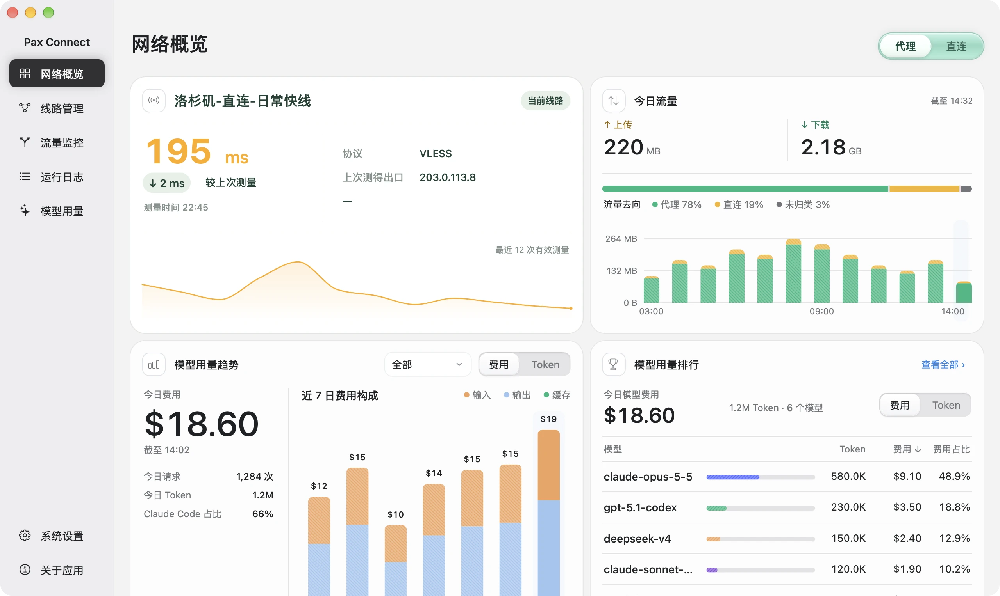
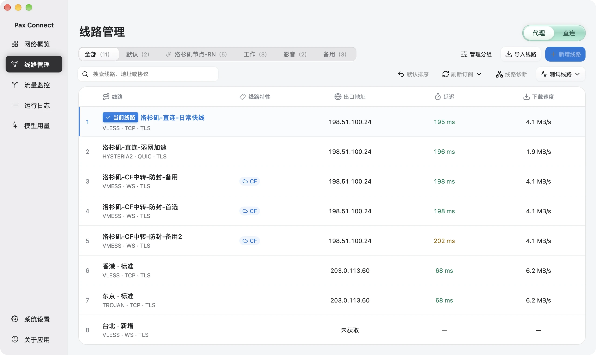
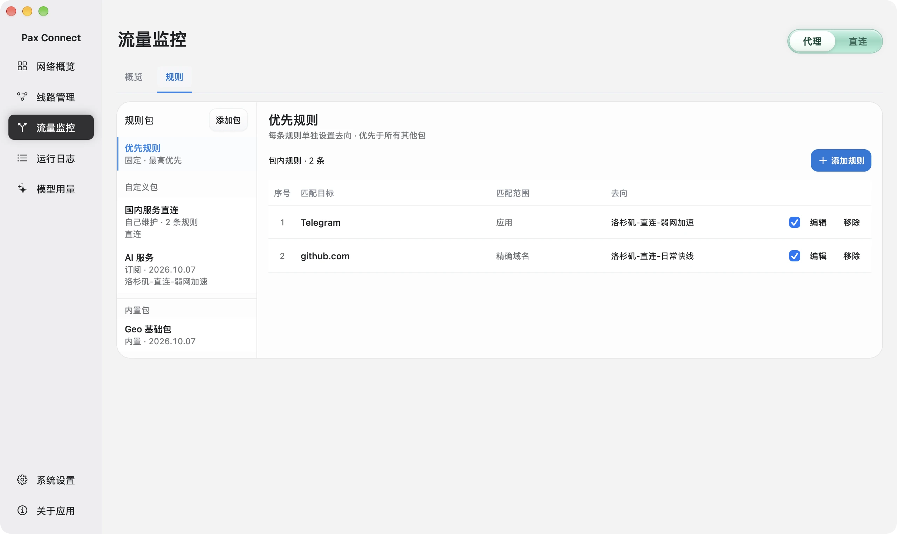
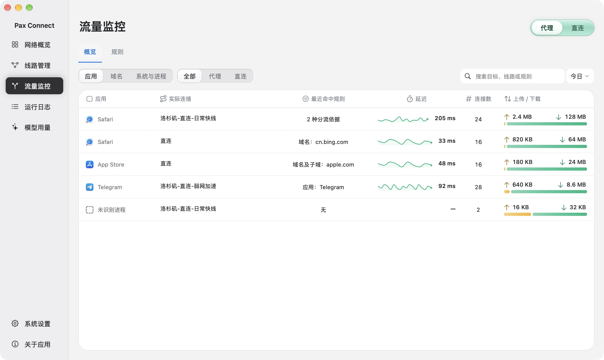
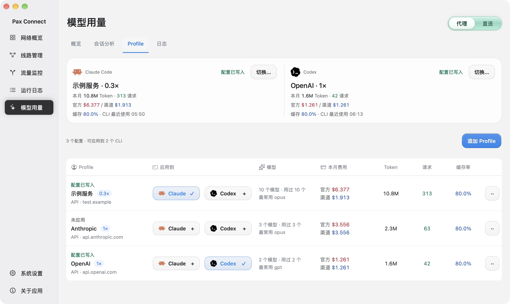
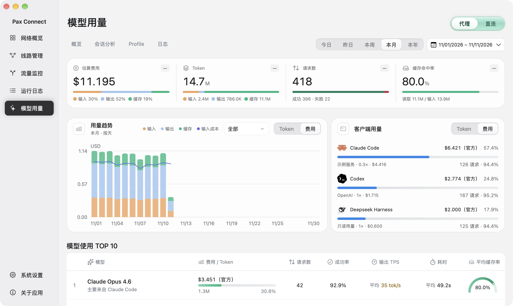
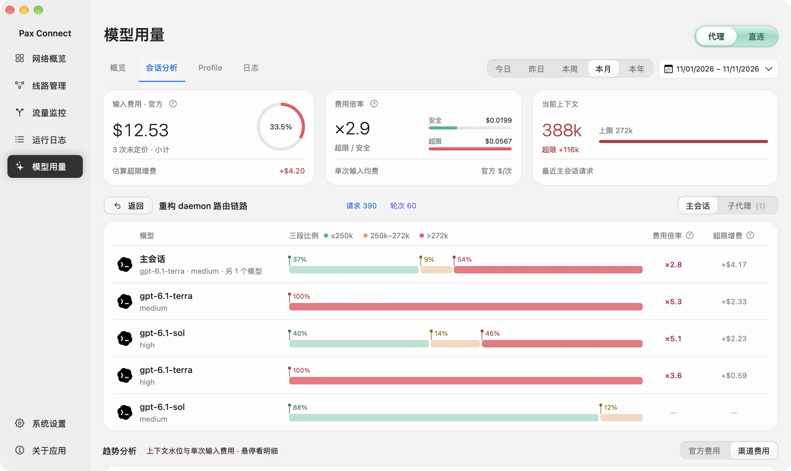
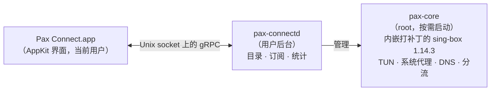

<div align="center">



# Pax Connect

**给 Claude Code 和 Codex 用的 Mac 代理客户端。**
分流上网、切换 API 配置、查看 Token 用量与费用，一个原生 App 全部搞定。

[](LICENSE)

[](https://github.com/Moore-developers/pax-connect-app/releases/latest)
[](https://github.com/SagerNet/sing-box)

[下载](https://github.com/Moore-developers/pax-connect-app/releases/latest) ·
[官网](https://paxconnect.top) ·
[从源码构建](#从源码构建) ·
[English](README.md)

<br>



<sub>演示模式，数据均为模拟。</sub>

</div>

## 它能做什么

Pax Connect 是基于 [sing-box](https://github.com/SagerNet/sing-box) 的 macOS 代理客户端，面向每天用 Claude Code 和 Codex 写代码的开发者，把三件事放进同一个 App：

- **走代理。** 用 TUN（或系统代理）接管系统流量，终端里的 `claude`、`codex` 不用再设置 `HTTPS_PROXY`。规则可按 `.app` 应用、域名或 IP 匹配，去向可选代理、直连或拦截。
- **管理 API 配置。** 保存多套 API 服务地址，选中后应用到 Claude Code（`settings.json`）和 Codex（`config.toml`）。保存和应用是两个独立步骤。
- **统计用量与费用。** 读取本机 Claude Code、Codex、DeepSeek Harness 的日志，按日期、模型、会话汇总 Token、缓存与估算费用。费用是按 API 价格折算的估算值，不是账单。

Pax Connect 是独立的第三方客户端，不是 sing-box 官方产品。它**不提供任何代理服务或线路**：线路（节点链接或订阅）和 API 服务都需要你自己准备。

## 截图

<table>
  <tr>
    <td width="50%"><br><b>线路管理</b><br><sub>导入节点链接或订阅，选择当前线路，测试延迟与速度。</sub></td>
    <td width="50%"><br><b>分流规则</b><br><sub>规则包；按应用、域名或 IP 的优先规则；去向为代理、直连或拦截。</sub></td>
  </tr>
  <tr>
    <td width="50%"><br><b>流量监控</b><br><sub>按应用查看实际线路、命中规则、连接数与传输量。</sub></td>
    <td width="50%"><br><b>API 配置</b><br><sub>Claude Code 与 Codex 卡片显示各自写入了哪套配置。</sub></td>
  </tr>
  <tr>
    <td width="50%"><br><b>模型用量</b><br><sub>估算费用、Token、请求数、缓存与客户端分布。</sub></td>
    <td width="50%"><br><b>会话分析</b><br><sub>主会话与子代理分开显示，并有逐请求趋势。</sub></td>
  </tr>
</table>

## 功能

**网络**

- TUN 接管或系统代理；切换线路时保留 TUN。
- 规则可按 `.app` 应用、域名、IP 匹配，去向为代理、直连或拦截。内置局域网/私有地址、Google、中国域名与中国 IP 规则包。
- 可选的广告拦截规则包（按域名拦截，**默认关闭**）。
- 流量与连接日志：按应用显示实际线路和命中规则。
- 若其他 VPN/TUN 工具占用了网络，Pax 会识别并提示你手动关闭，不会替你停止其他工具。

**线路**

支持导入分享链接和 Base64 订阅，涵盖以下协议（见 [`daemon/internal/importers`](daemon/internal/importers)）：

`VLESS`（含 Reality、Vision 流控、ws、httpupgrade）· `VMess` · `Trojan` · `Hysteria2`（salamander 混淆）· `AnyTLS` · `Shadowsocks`

不支持导入：Clash YAML、sing-box JSON、基于 XHTTP 的 VLESS。链接里不支持的参数会被明确拒绝，而不是悄悄丢弃。

**AI 工具**

- 本机用量：Claude Code、Codex、DeepSeek Harness，读取各自的本地日志（`~/.claude`、`~/.codex`、`~/.dsh`）。
- 会话分析，区分主会话与子代理。
- 把配置应用到 Claude Code 的 `settings.json` 和 Codex 的 `config.toml`。

## 安装

> **系统要求：** 搭载 **Apple Silicon** 的 Mac，系统为 **macOS 26 或更新**。不支持 Intel Mac。

1. 从[最新发布](https://github.com/Moore-developers/pax-connect-app/releases/latest)下载 DMG。
2. 打开后把 `PaxConnect.app` 拖进「应用程序」，推出 DMG，再从「应用程序」打开 Pax Connect。
3. 当前测试版**没有 Apple 公证**（无 Developer ID 签名），首次打开可能被 macOS 拦截。请打开「系统设置 → 隐私与安全性」，找到针对 Pax Connect 的提示，点「仍要打开」并确认。不要关闭 Gatekeeper。
4. 导入你自己的线路，然后开启代理。

需要知道的几点：

- **首次开启代理时，Pax 会请你输入一次管理员密码**（在 Pax 自己的安全输入框中输入），用于以 root 身份启动网络内核（`pax-core`）。Pax 不修改 `sudoers`，也不缓存密码；取消授权则代理保持关闭。这与上面的系统安全提示是两回事。
- 开启 TUN 前，请先**关闭其他 VPN / TUN 类应用**。
- **关闭窗口不会退出应用。** 按 **⌘Q** 退出 Pax 及其后台进程；关闭代理会释放 Pax 接管的网络。
- **界面目前只有中文。**
- **你的数据**（线路、订阅、API 配置、本地记录）位于 `~/Library/Application Support/Pax Connect/`，其中可能含有凭据，请勿分享。错误日志在 `~/Library/Logs/Pax Connect/`。更新或删除应用不会清除该目录；不支持降级。

## 隐私

- **App 内没有遥测或统计。**
- AI 用量**在本机读取 CLI 日志**，不经过任何 Pax 网关。你的 AI 请求仍由你的工具直接发给服务商。
- App 只在这些场景访问网络：你触发的订阅刷新、规则更新与网站图标；线路测试与诊断（测试目标、IP 信息、DNS、STUN）；以及用你保存的 API 地址获取模型目录。
- 凭据保存在本机私有文件中（权限 0600），这是文件权限，不是加密保险库。

详情见 [paxconnect.top/privacy](https://paxconnect.top/privacy/)。

## 工作原理



- App 以当前用户身份把 `pax-connectd` 作为子进程启动，负责线路目录、订阅、测速、配置生成和统计。
- `pax-core` 只在首次开启代理时以 root 启动，内嵌打过补丁的 [sing-box](https://github.com/SagerNet/sing-box) 1.14.3，负责 TUN、系统代理、DNS 与分流，随 App 退出。
- App 不直接连接 sing-box；App 唯一的 IPC 是 [`api/`](api) 中定义的 gRPC 接口。

详见 [`docs/architecture/runtime.md`](docs/architecture/runtime.md)、[`docs/architecture/singbox.md`](docs/architecture/singbox.md)（中文）。

## 从源码构建

**前置条件**

- Apple Silicon Mac，macOS 26
- Xcode 26+（Swift 6 工具链）
- Go 1.26.x（见 [`daemon/go.mod`](daemon/go.mod)）
- Python 3 与 `patch`（构建时用来准备 sing-box）
- `protoc` 及插件：**仅在重新生成 protobuf 代码时**需要，见 [`scripts/gen-proto.sh`](scripts/gen-proto.sh)。生成的代码已随仓库提交。

**构建**

```sh
make daemon                        # pax-connectd + pax-core（arm64）-> build/
make app                           # 先构建 daemon，再构建 AppKit App
scripts/package-release.sh 0.1.0   # Release App + DMG -> build/releases/
```

- `make app` 产物：`build/DerivedData/Build/Products/Debug/PaxConnect.app`。
- `scripts/package-release.sh <版本>` 使用临时（ad-hoc）签名，无 Developer ID、无公证，输出到 `build/releases/PaxConnect-<版本>-<构建号>-arm64/`。生成 DMG 需要图形登录会话和 Finder 自动化权限。
- Go 构建统一经由 `scripts/go.sh`：它会下载固定版本的 sing-box 与 sing-tun 源码，校验哈希后应用 [`patches/`](patches) 中的补丁，放进被 git 忽略的 `.tools/` 目录。
- `GOPROXY` 默认为 `https://goproxy.cn,direct`，可自行覆盖，例如 `GOPROXY=https://proxy.golang.org,direct make daemon`。

## 仓库结构

| 路径 | 内容 |
|---|---|
| `api/` | App ⇄ 后台、后台 ⇄ 内核的 Protobuf 定义 |
| `daemon/` | Go：`pax-connectd` 与 `pax-core` |
| `macos/` | AppKit App、Xcode 工程、Swift 包（UI、功能、gRPC 客户端） |
| `patches/` | 针对 sing-box 与 sing-tun 的补丁和保护代码 |
| `rulesets/` | 内置规则集（`.srs`）及清单 |
| `scripts/` | 构建、打包与代码生成脚本 |
| `third_party/` | 第三方许可文本 |
| `docs/` | 架构说明与图片 |

## 许可证

源码公开：内核 GPL-3.0 开源，App 界面禁止商用（PolyForm Noncommercial 1.0.0）。

- **App 界面**（`macos/`）：[PolyForm Noncommercial 1.0.0](macos/LICENSE)。商用须另行取得版权方授权，请通过 [GitHub issues](https://github.com/Moore-developers/pax-connect-app/issues) 联系。
- **接口定义**（`api/`）：[MIT](api/LICENSE)。
- **其余部分**（`daemon/`、`patches/`、`scripts/`、`rulesets/`、`docs/`）：**GPL-3.0**（[全文](third_party/licenses/GPL-3.0.txt)）。daemon 与 core 链接了 GPL-3.0-or-later 的 [sing-box](https://github.com/SagerNet/sing-box)，对 sing-box 与 sing-tun 的修改见 [`patches/`](patches)。

总览见 [LICENSE](LICENSE)。其他组件沿用各自许可证，详见 [THIRD_PARTY_NOTICES.md](THIRD_PARTY_NOTICES.md)。名称与图标适用 [TRADEMARKS.md](TRADEMARKS.md)。

**第三方商标。** Pax Connect 与 Anthropic、OpenAI、DeepSeek 无关联，也未获其认可。Claude、Claude Code、Codex、OpenAI、DeepSeek 等名称与图标归各自所有者，仅用于标识 Pax 所配合使用的工具。

**致谢。** [sing-box](https://github.com/SagerNet/sing-box) 及 SagerNet 各项目、[gRPC Swift](https://github.com/grpc/grpc-swift-2) 与 [SwiftNIO](https://github.com/apple/swift-nio) 团队、[v2fly domain-list-community](https://github.com/v2fly/domain-list-community)、[MaxMind GeoLite2](https://www.maxmind.com/)、[217heidai/adblockfilters](https://github.com/217heidai/adblockfilters)、[Simple Icons](https://simpleicons.org/)、[Lobe Icons](https://github.com/lobehub/lobe-icons)、[Lucide](https://lucide.dev/)。

Copyright (C) 2026 Moore-developers.
