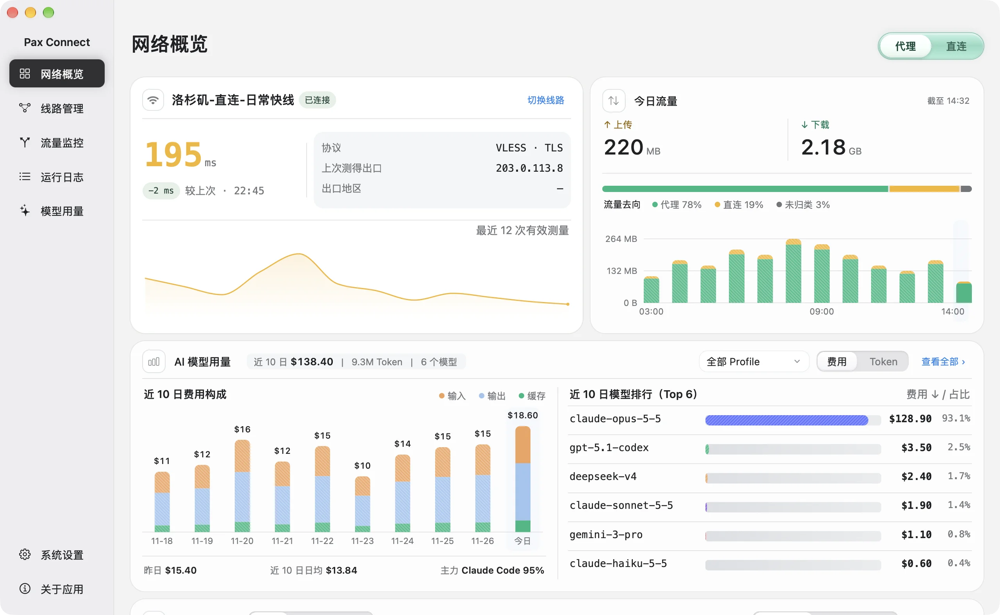
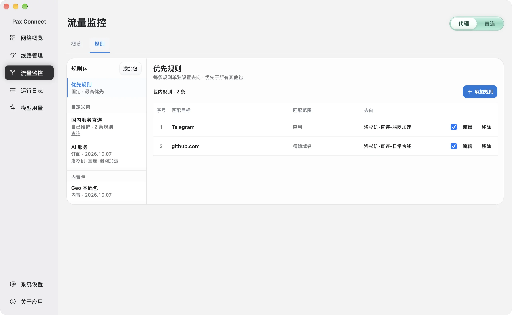
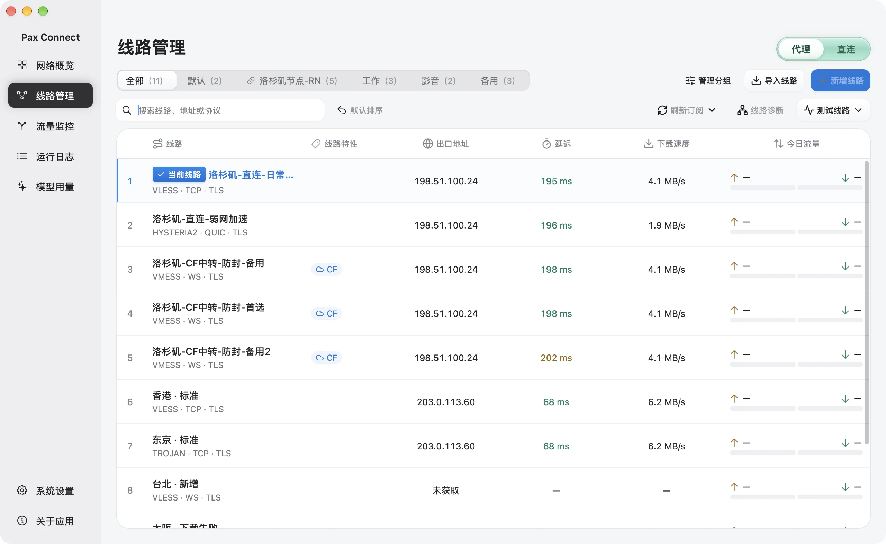
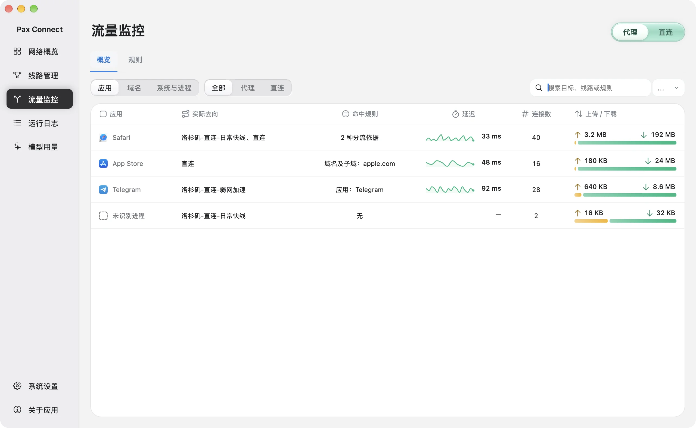
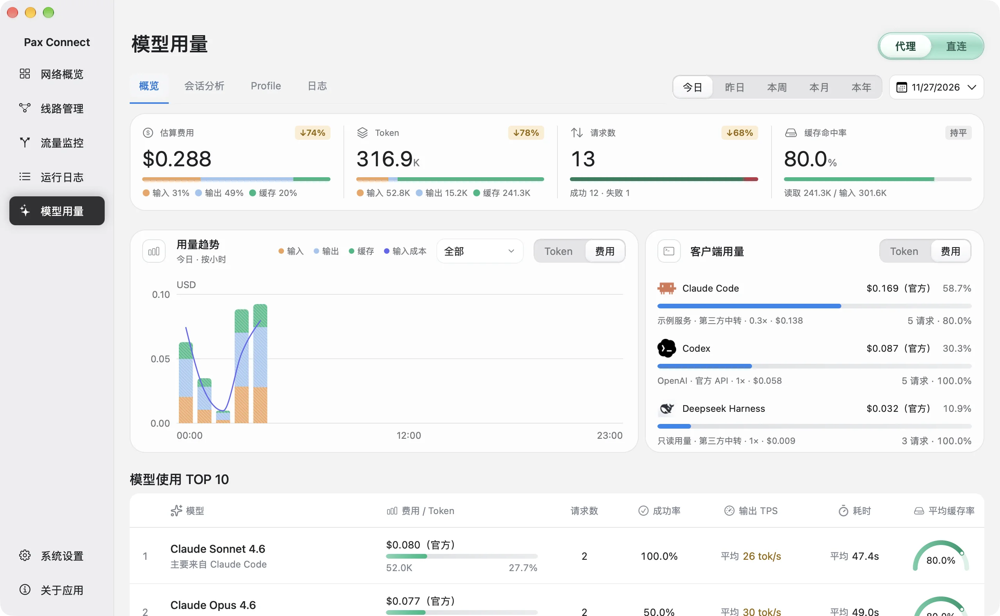
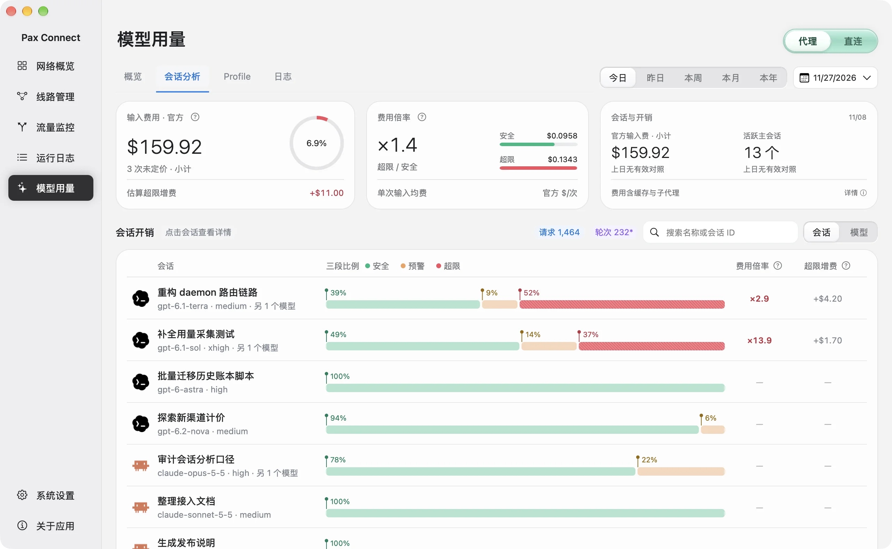
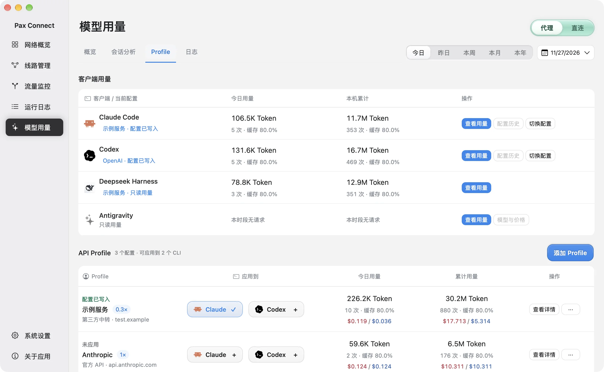
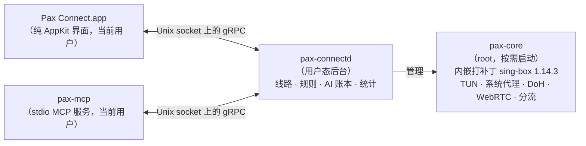

<div align="center">


# Pax Connect

**为 Mac 开发者打造的 Liquid Glass 原生代理——零配置起步，防漏不断线。**

纯 AppKit 界面，告别 Electron 和繁琐 YAML。默认国内外分流与 DNS/WebRTC 保护，固定线路掉了直接拦截，并把 Claude Code 与 Codex 的出口体检、Token 开销收在一处。

[](#安装)

[](https://github.com/SagerNet/sing-box)
[](https://github.com/Moore-developers/pax-connect-app/releases/latest)
[](LICENSE)

[下载安装包](https://github.com/Moore-developers/pax-connect-app/releases/latest) ·
[官网](https://paxconnect.top) ·
[对比 Clash / v2rayN](#专为-mac-开发者打造与通用客户端的区别) ·
[快速安装](#安装) ·
[English](README.md)

<br>



<sub>演示模式，数据均为模拟。Pax Connect 不提供任何代理节点或服务，线路和 API 请自备。</sub>

</div>

---

## 专为 Mac 开发者打造：与通用客户端的区别

通用代理工具负责把网接通，但真正在 Mac 上高频使用 Claude Code、Codex 时，终端配置、防漏校验与成本统计仍得东拼西凑。Pax 将整套链路收进同一个原生 Mac 界面：

- **零 YAML 起步：** 导入订阅、分享链接、Clash YAML 或 sing-box JSON 即可连接，免写规则文件，也不用配 `HTTPS_PROXY`。
- **纯原生 AppKit 工艺：** 基于 Swift 6 与 macOS 26 Liquid Glass 构建，主窗口与菜单栏联动控制，零 Electron 冗余开销。
- **AI 安全与账单原生内置：** 默认防漏分流、固定线路断线拦截、一键浏览器/Claude 体检，以及覆盖 4 端的本地 Token 核算。

| 对比项 | **Pax Connect** | **Clash Verge Rev / Clash** | **v2rayN** | **Surge** |
|---|---|---|---|---|
| **界面工艺** | 纯 AppKit · Liquid Glass | 跨平台 WebView（Tauri） | 跨平台桌面框架（Avalonia） | 原生 macOS / iOS |
| **开箱默认** | 内置国内外分流 + DoH/WebRTC 保护 | 需规则模板或手动覆写 YAML | 需手动调路由与内核参数 | 面向高阶规则与脚本 |
| **终端（`claude`、`codex`）** | TUN 接管 + 界面点选 `.app` / CLI 程序 | TUN 或手写规则 | TUN / 系统代理 | 增强模式 |
| **固定线路断线拦截** | 内置：绑定线路失效直接拒连并断旧连接 | 需自行编写容灾策略组 | 无内置 | 策略组 / 脚本 |
| **浏览器与 Claude 一键体检** | 内置：Mac vs 浏览器出口、Claude 6 项、DNS/WebRTC/IP | 无 | 无 | 无 |
| **AI 用量与 API 配置** | 本地读 4 款 AI 工具账单 + 一键切 Claude Code / Codex 配置 | 无 | 无 | 无 |
| **导入格式** | 节点链接、Base64、Clash YAML、sing-box JSON、SOCKS5/HTTP/HTTPS | 订阅链接、Clash YAML | 节点链接、订阅、JSON | Surge 配置 |
| **平台与价格** | macOS 26+（Apple Silicon）· 免费（Beta） | Win / Mac / Linux · 免费开源 | Win / Mac / Linux · 免费开源 | Mac / iOS · 付费（Mac \$49.99 起） |

> **选型建议：** 需要跨 Windows / Linux 使用同一客户端，选 **Clash Verge Rev** 或 **v2rayN**；需要 iOS 同步与 HTTPS MITM 抓包调试，选 **Surge**；**只在 Apple Silicon Mac 上开发，追求零配置、Liquid Glass 原生质感与 AI 防漏体验，选 Pax Connect。**

---

## 1. 默认分流，断线不漏直连



- **默认国内直连、海外走代理：** 随包内置离线 Geo 基线，默认 **局域网直连 → Google 代理**（优先于国内）**→ 国内域名与 IP 直连 → 其余海外代理**；另附可选广告拦截包（默认关闭）。
- **DNS 与 WebRTC 保护默认启用：** TUN 接管 DNS，海外走代理 DoH（`1.1.1.1`/`8.8.8.8`）、国内走国内 DoH（`223.5.5.5`/`119.29.29.29`），绝不降级明文（设置中可切 **严格 DNS 隐私**）。新装默认开启 WebRTC 公网 STUN 走代理。
- **点选应用与命令行分流：** 近期有流量的 `.app` 与 CLI（如 `claude`）按传输量置顶排列，点选即可指定走当前线路、**固定线路**、直连或拦截。
- **为 AI 账号准备的三道防线：** 一键开启内置 **Claude 规则包**（覆盖 Claude 及 Google 登录/Stripe/Persona）；TUN 运行期间**固定线路失效直接拒连并主动断开旧连接**，绝不静默回退直连；支持 **两跳链式线路**（中转 + 干净静态/住宅落地，含手动 `SOCKS5`/`HTTP`/`HTTPS`）。

---

## 2. 一键核验真实出口与 Claude 环境

仅在你主动点击检测时联网，绝不在后台静默探测：

- **对比 Mac 与真实浏览器出口：** 在默认浏览器后台运行无痕本地回环采样，精准抓出「系统走代理、浏览器走另一条出口」的隐蔽偏差。
- **Claude 6 项 + 本机 Keychain 核查：** 同步检测 Claude 网页出口、Anthropic API 出口、官方状态、Cloudflare 边缘节点、HTTP/TLS 版本，以及本机 `Claude Code-doctor-probe` 钥匙串残留。
- **泄露与多源 IP 对照：** 呈现真实 DNS 解析路径证据（bash.ws）、WebRTC STUN、IPv6、系统定位与语言时区；并行直查 IPQuery、ipwho.is、ip.sb、GeoJS、InternetDB 与 Cloudflare/IPinfo/IPIP，清晰标出各家来源分歧。

---

## 3. 线路管理、CF 优选与流量去向

<table>
  <tr>
    <td width="50%"><br><b>线路管理、两跳线路与今日流量</b><br><sub>延迟、地区与下载测速互不干扰；悬停今日上传/下载即显 5 分钟 / 1(2) 小时 / 24 小时进度标尺与今日前三目标。</sub></td>
    <td width="50%"><br><b>每个软件走哪条线，一目了然</b><br><sub>按应用、进程或域名查看真实出口、命中规则、连接数与拦截数，一键补规则，或检索 6 列本地 SQLite 日志。</sub></td>
  </tr>
</table>

- **内置 Cloudflare 优选工作台：** 物理直测 CF 边缘节点的延迟、地区与下载速度，经完整线路草稿验证连通后再保存生效。
- **超额提醒与菜单栏联动：** 按应用设置跨线路流量阈值，超额发送 macOS 系统通知；菜单栏常驻一键开关与切线（切线主动清掉旧连接，有其他 VPN/TUN 占用会明确提示）。

---

## 4. 提前识别上下文膨胀与 AI 费用

<table>
  <tr>
    <td width="50%"><br><b>4 款 AI 工具，本地统一核算</b><br><sub>本地读取 Claude Code、Codex、DeepSeek Harness 与 Antigravity 记录，汇总 API 等值估算费用、Token、缓存率、耗时与 TPS。</sub></td>
    <td width="50%"><br><b>看清什么时候该开新会话</b><br><sub>主会话与子代理分开核算，按安全/预警/超限三段标出成本占比、费用倍率与估算超限增费。</sub></td>
  </tr>
</table>

- **零代理网关、100% 本地只读：** 直接解析本机日志与 SQLite 文件，提示词与 API Key 不经过任何 Pax 网关。
- **及时发现上下文膨胀：** 按模型费用阈值把每次请求划入 **安全 / 预警 / 超限** 三段，直观给出费用倍率、超限增费以及主会话与子代理占比。

---

## 集成扩展：API Profile 与本地 MCP

<table>
  <tr>
    <td width="50%"><br><b>API Profile 切换（Claude Code &amp; Codex）</b><br><sub>自动识别官方账号、官方 API 与中转站。保存多套配置，预览差异后再写入 <code>settings.json</code> 或 <code>config.toml</code>。</sub></td>
    <td width="50%"><b>本地 MCP（8 类能力 · 59 个工具）</b><br><br>在 <b>设置 → MCP</b> 一键接入 Claude Code、Codex 或 DeepSeek Harness。默认仅开启 <b>只读权限</b>，线路修改、代理控制、诊断、Profile 与 CF 优选按需授权。<br><br><sub>可以直接对你的 AI 助手说：</sub><br><sub>• <i>「查一下 Pax 日志，看看刚才 Anthropic API 为什么超时，并跑次线路诊断。」</i></sub><br><sub>• <i>「帮我看看这周哪条会话上下文超限多花的钱最多。」</i></sub></td>
  </tr>
</table>

---

## 安装

> **系统要求：** **Apple Silicon** 的 Mac，系统 **macOS 26 及以上**。不支持 Intel Mac。

1. 从 [最新发布页](https://github.com/Moore-developers/pax-connect-app/releases/latest) 下载 DMG。
2. 将 `PaxConnect.app` 拖入「应用程序」，推出 DMG 后启动。
3. **首次打开（暂无公证）：** 打开 **系统设置 → 隐私与安全性**，找到 Pax Connect 点击 **仍要打开** 确认。*（请勿关闭 Gatekeeper。）*
4. 导入你自己的线路（或手动新增代理），开启主开关即可使用。

<details>
<summary><b>首次使用注意事项 &amp; 本机数据位置</b></summary>

- **首次开代理输一次管理员密码：** 在 Pax 安全输入框中输入，用于以 root 启动 `pax-core`。不改 `sudoers`，不缓存密码。
- **开启 TUN 前请先关闭其他 VPN / TUN 软件。**
- **关闭窗口不退出应用**（保留菜单栏常驻）。按 **⌘Q** 彻底退出 Pax 及全部后台；关闭代理即还原系统网络。
- **语言与数据：** 设置中可即时切换 简体中文 / English。本机数据保存在 `~/Library/Application Support/Pax Connect/`（`0600` 私有权限，含凭据请勿分享）；错误日志在 `~/Library/Logs/Pax Connect/`。

</details>

---

## 隐私与边界说明

- **零遥测，不提供节点。** Pax Connect 是独立客户端（非 sing-box 官方产品），不埋点、不建账号，也不提供代理节点或 API 额度。
- **安全边界：** 固定线路断线拦截只在 Pax 与 TUN 运行期间生效，不含崩溃后的系统级防火墙兜底；应用自带 DoH 或未经过 TUN 的流量不在 TUN DNS 接管范围内。
- **费用与凭据：** AI 费用是基于公开单价与本地日志的 API 等值估算，并非账单；凭据以 `0600` 文件权限存本机，非加密保险库。
- **MCP 边界：** 用 MCP 时 Pax 须已运行，查询所得日志、域名与会话可能被 AI 客户端发往其模型服务商。详见 [paxconnect.top/privacy](https://paxconnect.top/privacy/)。

---

## 技术细节

<details>
<summary><b>支持的协议与导入格式</b></summary>

支持分享链接、Base64 订阅、Clash/Mihomo YAML、sing-box JSON 与手动录入（见 [`daemon/internal/importers`](daemon/internal/importers)）：

- **隧道协议：** `VLESS`（含 REALITY、Vision、WebSocket、HTTPUpgrade，及 TLS/REALITY 下单服务 gRPC）· `VMess` · `Trojan` · `Hysteria2`（salamander）· `AnyTLS` · `Shadowsocks`
- **手动代理：** `SOCKS5` · `HTTP` · `HTTPS`（支持认证与 SNI）
- 暂不支持的格式（如 VLESS XHTTP、多路模式 gRPC）导入时会直接报错说明原因。

</details>

<details>
<summary><b>工作原理（进程与权限隔离）</b></summary>



- `Pax Connect.app` 以普通用户运行并拉起 `pax-connectd`；`pax-core` 仅在开代理时以 root 启动，内嵌经校验的打补丁 [sing-box](https://github.com/SagerNet/sing-box) 1.14.3，随 App 退出。
- 界面和 `pax-mcp` 均通过 [`api/`](api) 的 gRPC 接口通信。详见 [`docs/architecture/runtime.md`](docs/architecture/runtime.md)、[`docs/architecture/singbox.md`](docs/architecture/singbox.md)。

</details>

<details>
<summary><b>从源码构建与仓库目录</b></summary>

**前置条件：** Apple Silicon Mac（macOS 26）、Xcode 26+（Swift 6）、Go 1.26.x（[`daemon/go.mod`](daemon/go.mod)）、Python 3、`patch`。

```sh
make daemon                        # 构建 pax-connectd + pax-core（arm64）-> build/
make app                           # 构建 daemon + AppKit App -> build/DerivedData/...
scripts/package-release.sh 0.1.9   # 生成临时签名 Release App + DMG -> build/releases/
```

Go 构建经由 `scripts/go.sh` 拉取固定版本 sing-box/sing-tun 并应用经校验的 [`patches/`](patches) 补丁。可覆盖 `GOPROXY`：`GOPROXY=https://proxy.golang.org,direct make daemon`。

| 路径 | 内容 |
|---|---|
| `api/` | Protobuf 定义（`App/MCP ⇄ 后台`、`后台 ⇄ 内核`） |
| `daemon/` | Go：`pax-connectd`、`pax-core`、`pax-mcp` |
| `macos/` | 纯 AppKit App、Xcode 工程与 Swift 包（`PaxUI`、`Features`、`PaxCore`、`PaxClient`） |
| `patches/` | 给 sing-box 与 sing-tun 的校验补丁 |
| `rulesets/` | 内置离线 `.srs` 规则集与清单 |
| `scripts/` | 构建、打包与代码生成脚本 |
| `docs/` | 架构文档与截图 |

</details>

---

## 许可证与致谢

- **App 界面**（`macos/`）：[PolyForm Noncommercial 1.0.0](macos/LICENSE)（商用须另行授权，请提 [GitHub issues](https://github.com/Moore-developers/pax-connect-app/issues)）。
- **接口定义**（`api/`）：[MIT](api/LICENSE) · **内核及其他部分**（`daemon/`、`patches/`、`scripts/`、`rulesets/`、`docs/`）：**GPL-3.0**（[全文](third_party/licenses/GPL-3.0.txt)），链接 [sing-box](https://github.com/SagerNet/sing-box)。

总览见 [LICENSE](LICENSE)、[THIRD_PARTY_NOTICES.md](THIRD_PARTY_NOTICES.md) 和 [TRADEMARKS.md](TRADEMARKS.md)。与 Anthropic、OpenAI、Google、DeepSeek 无关联。

**致谢：** [sing-box](https://github.com/SagerNet/sing-box)、[gRPC Swift](https://github.com/grpc/grpc-swift-2) 与 [SwiftNIO](https://github.com/apple/swift-nio)、[v2fly domain-list-community](https://github.com/v2fly/domain-list-community)、[MaxMind GeoLite2](https://www.maxmind.com/)、[217heidai/adblockfilters](https://github.com/217heidai/adblockfilters)、[Simple Icons](https://simpleicons.org/)、[Lobe Icons](https://github.com/lobehub/lobe-icons) 与 [Lucide](https://lucide.dev/)。

如果 Pax Connect 帮到了你，欢迎点个 **Star** 支持一下；遇到协议或分流问题，欢迎随时提 [Issue](https://github.com/Moore-developers/pax-connect-app/issues)。

Copyright (C) 2026 Moore-developers.
